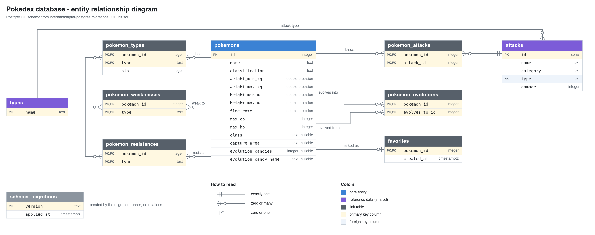

# Pokedex API

A Go + PostgreSQL REST API over the 151 Pokemon in [`pokemons.json`](pokemons.json).
The original challenge is in [`docs/CHALLENGE.md`](docs/CHALLENGE.md).

## Run it

**Prerequisites:** Docker (Compose v2) and `make` to run the app. Go 1.26+ is only needed to run the tests or the linter on your machine, because the app is built inside Docker.

Run all commands from the project folder. `make help` lists them.
The API is at **http://localhost:8080**.

| I want to... | Command |
|---|---|
| Start everything (database, data, API) | `make start` |
| Stop everything (**data is kept**, including favorites) | `make stop` |
| Delete all data and start clean | `make reset` |
| See the API logs | `make logs` |
| Run the tests | `make test` (no database needed) or `make test-integration` (also tests PostgreSQL) |
| Check formatting and `go vet` | `make lint` |
| Smoke-test the running API | `./scripts/test-api.sh` after `make start` (it resets favorites 25 and 150) |

`make start` runs in the background and loads `pokemons.json` for you. It also rebuilds the image, so run it again after a code change. Loading the data again is safe and keeps your favorites. The data is stored in a Docker volume (`pgdata`), so it stays after `make stop`. Only `make reset` deletes it.

`make test` and `make test-integration` need Go 1.26+ on your machine. If `TEST_DATABASE_URL` is not set, the PostgreSQL tests are skipped. Each test uses its own temporary schema, so your application data is safe.

### Configuration

To change a port or the database login, copy [`.env.example`](.env.example) to `.env` and edit it. Docker Compose and the Makefile both read `.env`. Every value is optional.

| Variable | Default | Used for |
|---|---|---|
| `DB_PORT` | `5432` | Database port on your machine |
| `API_PORT` | `8080` | API port on your machine |
| `POSTGRES_USER` | `pokedex` | Database user |
| `POSTGRES_PASSWORD` | `pokedex` | Database password |
| `POSTGRES_DB` | `pokedex` | Database name |

After changing `.env`, run `make start` again. Changing the user, password or database name on an existing database needs `make reset`, because PostgreSQL only reads them when it creates the data.

The Makefile builds `DATABASE_URL` from these values for `make test-integration`. Docker Compose builds the URL for the containers, using the host `db`. You can set `DATABASE_URL` yourself when you run `make`.

## API

After `make start`, you can copy and run these examples:

```bash
# 1. Pokemon by id
curl localhost:8080/pokemons/25

# 2. List (paginated)
curl 'localhost:8080/pokemons?page=2&page_size=10'

# 3. Pokemon by name (case-insensitive, exact)
curl localhost:8080/pokemons/name/pikachu

# 4. List with filters (all filters can be combined)
curl 'localhost:8080/pokemons?name=char&weakness=water'
curl 'localhost:8080/pokemons?type=fire&type=flying&resistant=bug&sort=maxCP&order=desc'
curl 'localhost:8080/pokemons?class=legendary&favorite=true'

# 5. By type (same paging/sort/filters as the list); GET /types lists the types
curl localhost:8080/types
curl localhost:8080/types/dragon/pokemons

# 6. Add favorite (204)
curl -X PUT localhost:8080/favorites/25

# 7. Remove favorite (204)
curl -X DELETE localhost:8080/favorites/25

# 8. List favorites (same paging/sort/filters as the list)
curl localhost:8080/favorites

# Health check, and an error example (404)
curl localhost:8080/healthz
curl -i localhost:8080/pokemons/9999
```

The full contract is in [`docs/openapi.yaml`](docs/openapi.yaml).

Details:
- Lists return `{"items": [...], "total": 151, "page": 1, "pageSize": 20, "totalPages": 8}`. `page` is 1 by default and must be at least 1. `page_size` is 20 by default and has a maximum of 100. A `0` for either one gives `400`.
- `GET /types/{type}/pokemons` gives `404` for an unknown type.
- You can combine filters. `type` can be repeated and means "has all these types". `name` is a case-insensitive partial match. `class` is `legendary` or `mythic`.
- `sort` is `id` (default), `name`, `maxCP` or `maxHP`. `order` is `asc` (default) or `desc`. The id is always the last sort key, so pages stay stable.
- Every pokemon has an `isFavorite` flag.
- Favorite `PUT` and `DELETE` are idempotent. An unknown pokemon gives `404`. Bad input gives `400` with `{"error": "..."}`. Unexpected errors give a generic `500`. They are logged but not shown to the user.

## Architecture

The project uses hexagonal (ports-and-adapters) architecture. Dependencies point inward:

```
cmd/api, cmd/seed          composition roots (wiring only)
internal/domain            entities, query types, sentinel errors (imports nothing from the project)
internal/app               use cases (Service) + the Repository port it needs
internal/adapter/httpapi   HTTP/JSON adapter (handlers, DTOs); depends on a small Service interface
internal/adapter/postgres  Repository implementation, migrations, seeding
internal/adapter/jsonfile  pokemons.json → domain parser
```

### How the files work together

Imports only point inward. `httpapi` and `postgres` never import each other. Only `cmd/api` connects them.

```
cmd/api  ──► httpapi  ──► domain
         ──► app      ──► domain
         ──► postgres ──► domain

cmd/seed ──► jsonfile ──► domain
         ──► postgres
```

`postgres` also imports `app`, but only to check at compile time that `Repository` implements `app.Repository`.

The two programs share only the database at runtime:

```
API request:   handler ──► service ──► repository ──► PostgreSQL
               (parse)     (validate)  (SQL)

API startup:   connect ──► Migrate ──► build Repository, Service, Handler ──► listen

Seed program:  jsonfile.Parse ──► connect ──► Migrate ──► Seed ──► exit
```

With Docker, `make start` runs `db`, then `seed`, then `api`. Each one waits for the one before it, so the API always starts with data loaded.

- `Migrate` runs once at startup, in both programs. It only creates the tables. It is not part of a request.
- `domain.Pokemon` is the shared format. `jsonfile` creates it, `Seed` writes it, `Repository` reads it, and `httpapi/dto.go` turns it into JSON.
- Errors such as `domain.ErrNotFound` start in the repository, pass through the service unchanged, and become `404` in the handler.

Choices and reasons:

- **Go 1.22+ `net/http` `ServeMux`** (method + path patterns) instead of a router framework. It does everything we need, so there is no extra dependency.
- **`pgx` v5, no ORM.** The queries are simple SQL with bound parameters. The dynamic parts (filters, ORDER BY) are built from approved fragments, never from raw input. The relations for a page of results are loaded with one query per relation (`= ANY($1)`), so there is no N+1 problem.
- **The consumer declares the interfaces** (`app.Repository`, `httpapi.Service`). This keeps the layers separate and lets us test the service and handlers with simple fakes.
- **Separate DTOs** for the JSON format, so the API can change without changing the domain model.
- **Small built-in migration runner** (`schema_migrations` table). With one migration, a separate tool is too much (YAGNI). The SQL files are plain, so we can move them to a real tool later.
- **Standard `log/slog`** for structured logs, and a graceful shutdown on SIGTERM.

## Database design: why PostgreSQL, and why normalized

The challenge lets us choose between PostgreSQL and MongoDB, so this was a real decision. The data looks like documents, which favors MongoDB. But the requirements are about *relations*: filter by type, weakness and resistance, and list by type. Many pokemons share the same types, and they also share attacks (for example "Tackle"). Evolutions point to other pokemons. PostgreSQL handles these relations with foreign keys, indexes and constraints. Favorites are also a simple relational idea.

### PostgreSQL vs MongoDB

| Aspect | PostgreSQL (chosen) | MongoDB |
|---|---|---|
| Loading `pokemons.json` | Needs a mapping step that splits each pokemon into several tables | Almost a direct insert, because each pokemon is already a document |
| Read one full pokemon | Several queries (one per relation), or joins | One read |
| Filter by type, weakness or resistance (stories 4 and 5) | Indexed lookups on small join tables. Combining filters is plain SQL | Multikey indexes on arrays work well, but combining several filters and sorting needs careful index design |
| Shared data (types, attacks, evolutions) | Stored once and linked by foreign keys | Copied into every document and kept consistent by the application, or linked and joined with `$lookup` |
| Integrity (favorite of a missing pokemon, invalid class) | Enforced by foreign keys and `CHECK` constraints | Enforced in application code (schema validation checks the shape, not the references) |
| Favorites (stories 6-8) | A table with a foreign key. A filter such as `favorite=true` is a join | A flag on the document or a separate collection. Both work, but the flag mixes user data with catalog data |
| Schema changes | Explicit migrations | Flexible, with no migration step, but the code must handle old and new shapes |
| Scale | More than enough for 151 rows. Scales up with a bigger server and read replicas | Horizontal sharding, which this dataset does not need |
| Operational cost | One container, and it is already the team's stack | One container, but a second technology to learn and run if the team already uses PostgreSQL |

**Why PostgreSQL won:** the user stories mostly query *across* relations. They rarely fetch whole documents. The database can also keep those relations valid. The costs are a seeding step that normalizes the JSON, and a more expensive "read one pokemon". We reduce the second cost by loading each relation for a whole page in one query (`= ANY($1)`).

**When MongoDB would be better:** if pokemons had very different attributes, if reads were almost always "get the whole document by id", or if writes needed horizontal scaling.

**Switching later:** the use cases depend only on the `app.Repository` port. A MongoDB version would be a new adapter next to `internal/adapter/postgres`. The service and the HTTP layer would not change.



Schema ([`001_init.sql`](internal/adapter/postgres/migrations/001_init.sql)):

- `pokemons`: simple attributes. Weight and height are stored as numeric min and max (`"6.04kg"` → `6.04`), so they can be sorted and filtered. `class` (LEGENDARY/MYTHIC) and `capture_area` can be null.
- `types`, `pokemon_types` (with `slot` to keep the order), `pokemon_weaknesses`, `pokemon_resistances`: all indexed by type.
- `attacks` (unique per name + category) and `pokemon_attacks`.
- `pokemon_evolutions (pokemon_id, evolves_to_id)`: each relation is stored once. "Previous evolutions" is the reverse lookup.
- `favorites (pokemon_id)`.

## Decisions about the source data

`pokemons.json` has some quirks. They are handled in [`jsonfile`](internal/adapter/jsonfile/jsonfile.go) and [`seed.go`](internal/adapter/postgres/seed.go):

- Ids are zero-padded strings (`"001"`). They are stored as integers.
- Class and capture area appear as odd keys (`"Pokémon Class": "This is a LEGENDARY Pokémon."`, plus stray keys like `"LEGENDARY": "Pokémon Class"` or `"Asia"`). They are cleaned up into `class` and `captureArea`.
- Evolution links are inconsistent. Jigglypuff and Wigglytuff point to themselves. Dragonite lists Dratini, but Dratini does not list Dragonite. The seed stores the **union of both directions** and drops links to self.
- Seeding is an idempotent upsert in one transaction. Running it again keeps favorites.

## How this maps to the evaluation criteria

| Criterion | Where to look and why |
|---|---|
| **Functional review** | All 8 user stories are done (see the [API examples](#api)). Filters can be combined, lists are paginated in a stable order, favorites are idempotent, and errors map to `400`, `404` and `500`. |
| **Code structure** | Hexagonal architecture (see [Architecture](#architecture)). The domain imports nothing from the project. The use cases are in `internal/app`. HTTP, PostgreSQL and JSON parsing are separate adapters. `cmd/*` only wires them together. |
| **Implementation details** | The consumer declares the interfaces (dependency inversion). Handlers, service and repository each have one job (single responsibility). Validation is in one place, `normalize` (DRY). We build nothing before we need it: no ORM, no router framework, no migration tool (YAGNI). |
| **Code readability** | Small files, simple SQL, doc comments on ports and exported functions, and comments on the schema choices that are not obvious. |
| **Evolutionary code** | New storage means a new `Repository` implementation. A new API format means a new adapter or DTO. See [Assumptions and next steps](#assumptions-and-next-steps) for users, search at scale and migrations. |
| **Automated tests** | `make test` runs the unit tests without a database: the service, the HTTP handlers (with fakes) and the JSON parser. `make test-integration` also runs the repository and seeding tests on a real PostgreSQL, each in its own temporary schema. |
| **Documentation** | This README covers how to run and test, the API, the architecture, the PostgreSQL vs MongoDB decision, the data quirks, and the assumptions. |

## Assumptions and next steps

- The requirements have no users, so **favorites are global**. For many users, add `user_id` to the `favorites` primary key and add authentication. The port (`AddFavorite(ctx, id)`) would then take the user from the context.
- Name search uses `ILIKE '%…%'`, which is fine for 151 rows. For a larger catalog, use a `pg_trgm` index.
- Out of scope, so not included: authentication, rate limiting, metrics.
